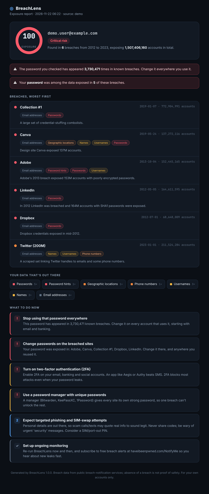

# BreachLens: have you been exposed in a data breach?

BreachLens checks whether your email and passwords have leaked in known data breaches, then tells you in plain English **what leaked, how bad it is, and exactly what to do about it.** It's the kind of "have I been exposed?" check sites like Pentester offer — as a tool you run yourself.



- **Email breach lookup** — which breaches exposed your email, when, how many accounts, and what data (passwords, phone, address, financial…)
- **Exposure score + risk level**, worst breaches first, color-coded by how sensitive the leaked data is
- **Password check that never sends your password** — it uses *k-anonymity*: only the first 5 characters of your password's hash ever leave your computer
- **A tailored action plan** — change these passwords, turn on 2FA, watch for SIM-swap, etc.
- **A polished HTML report** you can save or hand to a client, plus a **local web UI**
- **Works out of the box, no API key** (uses the free XposedOrNot service), with optional Have I Been Pwned support

> ⚠️ Only check email addresses and passwords that are yours, or that you have permission to check.

---

## Quick start

```bash
# See a sample report first (simulated data, no network)
python3 breachlens.py demo
```

```bash
# Check your own email
python3 breachlens.py check you@example.com
```

```bash
# Check an email AND a password (password is prompted, hidden, and never sent)
python3 breachlens.py check you@example.com --check-password
```

```bash
# Local web UI — type an email in your browser
python3 breachlens.py serve
#   → open http://127.0.0.1:8088
```

```bash
# Just test a password
python3 breachlens.py password
```

```bash
# Save a shareable HTML report
python3 breachlens.py report you@example.com -o report.html
```

## Commands

| Command | What it does |
|---|---|
| `check <email>` | Check an email, print a report. `--check-password`, `-o report.html`, `--json` |
| `report <email>` | Write an HTML report (default `breachlens-<email>.html`) |
| `password` | Check a single password (hidden input, k-anonymity) |
| `serve` | Local web UI at `http://127.0.0.1:8088` (`--port`) |
| `demo` | Sample report with simulated data, no network (`-o file.html`) |
| `set-key` | Save a Have I Been Pwned API key |

Add `--source xposedornot` or `--source hibp` to force a source (default `auto`: HIBP if a key is set, otherwise XposedOrNot).

## How the password check protects you (k-anonymity)

Your password is **never sent anywhere.** BreachLens:

1. Hashes the password with SHA-1 locally.
2. Sends only the **first 5 characters** of that hash to the Pwned Passwords service.
3. Gets back every hash *suffix* starting with those 5 characters (hundreds of them).
4. Looks for a match **on your machine**.

So the service never learns your password, your full hash, or even which account you're checking. The test suite asserts this — it captures exactly what gets sent and verifies only the 5-character prefix leaves. (Your *email*, on the other hand, is sent to the breach-lookup service, because that's the lookup. BreachLens tells you this.)

## Data sources

| Source | Key needed? | Notes |
|---|---|---|
| **XposedOrNot** | No | Free email breach lookup. The default. |
| **Have I Been Pwned** | Yes (~$4/mo) | The authoritative source. Set it with `set-key`. |
| **Pwned Passwords** | No | Free, privacy-preserving password checks. |

To use HIBP:

```bash
python3 breachlens.py set-key          # paste your key from haveibeenpwned.com/API/Key
```

The key is stored in `~/.config/breachlens/config.json` with `600` permissions (only you can read it). You can also set `HIBP_API_KEY` in the environment.

## What it does *not* do

BreachLens reports **exposure and remediation only.** It never downloads stolen credential dumps, and it never reveals anyone's plaintext password — not yours, not anyone's. "Is my password in a breach?" is answered with a yes/no + count, never by showing a password.

## Run the tests

```bash
python3 tests/test_breachlens.py
```

The tests mock every network call, so they run offline. They cover breach parsing (both sources), risk scoring, HTML-injection safety, and the password-privacy guarantee.

## Ideas to take it further

- **Monitor mode:** re-check your emails on a schedule and alert (Telegram/email) when a *new* breach appears — pairs naturally with a tool like NetWatch.
- **Bulk/domain check:** scan every address at a domain you own (HIBP supports this).
- **Username & social lookup:** check where a username exists across sites.
- **Branded PDF reports:** sell breach/exposure audits to small businesses.

## Legal & privacy

Only look up accounts you own or are authorised to check. Breach data comes from public breach-notification services; the absence of a breach is not proof of safety — it only means nothing is *known*. BreachLens stores nothing about the people you look up beyond the optional HIBP key in your own config file.
